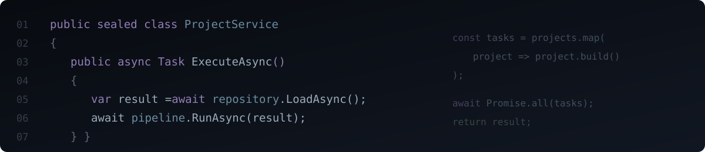

# Olá, eu sou o Aron

Estudante de **Análise e Desenvolvimento de Sistemas**, construindo meu portfólio e buscando uma oportunidade de estágio em desenvolvimento de software.

Tenho interesse em transformar ideias em aplicações, entender como os sistemas funcionam e aprender com desafios práticos.

### O que estou aprendendo

`C#` · `.NET` · `Lógica de programação` · `Git e GitHub` · `Testes e documentação`

### Projetos

Aqui reúno projetos pessoais e estudos práticos. Cada repositório apresenta seu objetivo, o que foi desenvolvido e os aprendizados ao longo do caminho.
  
| Projeto | Sobre |
| --- | --- |
| [Living Society](https://github.com/aronbrsl/living-society) | Simulação social para RimWorld, com foco em integração de sistemas, comportamentos e persistência. |

[Ver todos os repositórios](https://github.com/aronbrsl?tab=repositories)

### Como trabalho

Gosto de explorar ideias, organizar requisitos e melhorar os projetos a partir de testes e feedback. Uso IA como apoio criativo e técnico durante o aprendizado.

### Oportunidades

Busco estágio para aprender com uma equipe, fortalecer minha base em desenvolvimento e contribuir com projetos reais.
